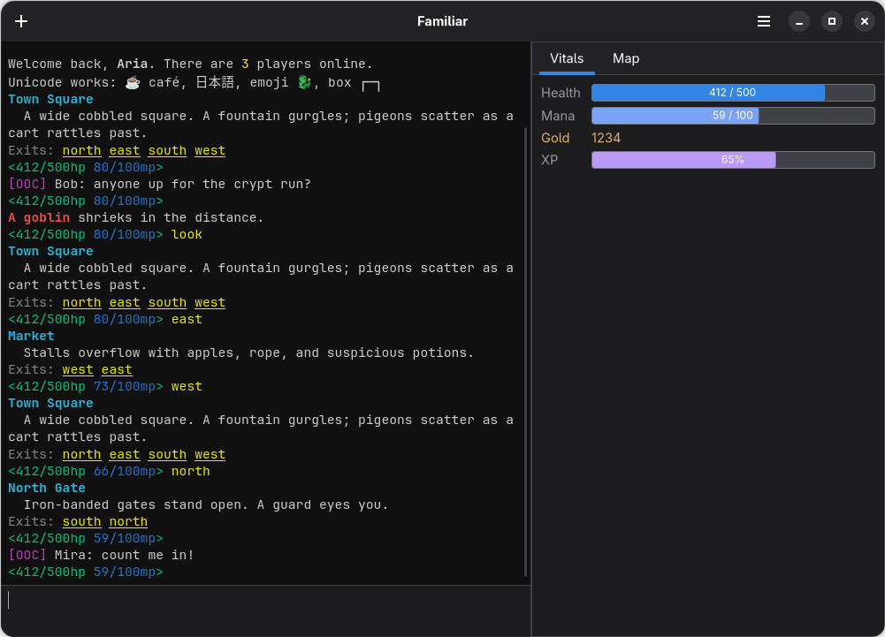
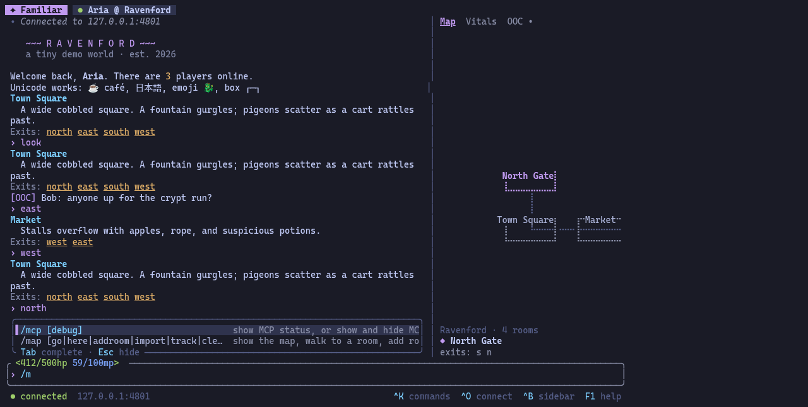
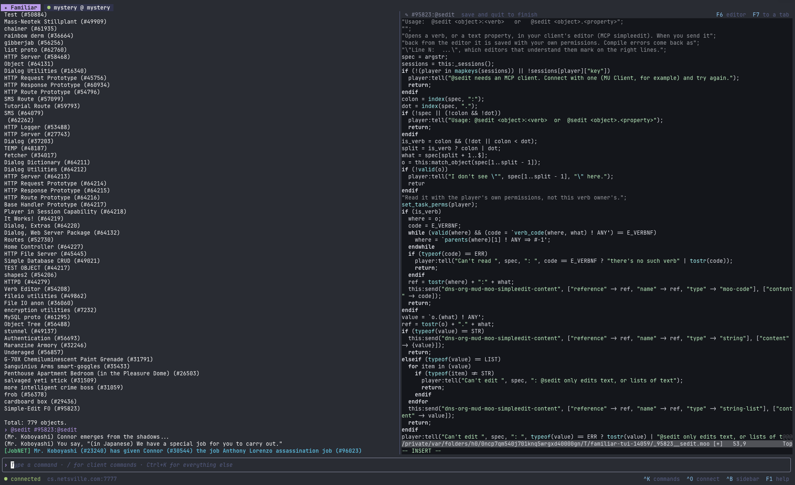

<p align="center"></p>

# Familiar

A client for MUDs, MUSHes, MUCKs and MOOs, for Linux, Windows and macOS: a desktop app (GTK 4 on
Linux and Windows, a native app on macOS) and a full-screen terminal app that share one engine,
settings, scripts and maps.

Familiar is inspired by [BeipMU](https://github.com/BeipDev/BeipMU), the Windows client, and can
import its settings, maps and scripts. It is a separate project, written from scratch in Rust, and
isn't affiliated with BeipMU or its developers.

| GTK | Terminal | Terminal, with `$EDITOR` beside the world |
|---|---|---|
|  |  |  |

## Highlights

- Tabs for each world; colour (16, 256 and truecolor) and full Unicode output; clickable links; logging.
- Triggers, aliases, keyboard macros and variables, with an editor; JavaScript scripting (QuickJS).
- GMCP: stat bars (`Beip.Stats`), server sounds (`Client.Media`), web views, and a map that draws
  itself from `Room.Info` and walks you to any room. Tilemaps, avatars and inline images.
- MCP 2.1, with a program editor that highlights and auto-indents MOO (Stunt) and MUF.
- Puppets in their own tabs, text to speech, spell checking.
- Imports BeipMU's `Config.txt`, `.atlas` maps and scripts.
- A terminal client in the style of modern coding assistants: command palette, fuzzy world picker,
  `/` completion, split scrollback, a sidebar with the map and stats, and `$EDITOR` for programs.

## Installing

**Windows:** each release has an installer (`familiar-…-windows-setup.exe`) and a zip of the same
files (unpack it anywhere and run `Familiar.cmd`). Both contain everything the app needs, GTK
included, so there is nothing else to install. They also contain the terminal client,
`familiar-tui.exe`, which is available on its own too: one file with no dependencies, best run in
Windows Terminal. Windows 10 or newer, 64-bit. See [Windows notes](#windows-notes) for what differs.

**macOS:** each release has `Familiar-…-macos.zip`, the app (unzip it and drag Familiar to
Applications), and `familiar-tui-…-macos.tar.gz`, the terminal client on its own
(`cargo install familiar-tui` works too). Both run on Apple silicon and Intel Macs, macOS 14 or
newer. See [macOS notes](#macos-notes) for what differs.

**Arch Linux (AUR):** `familiar` (releases) or `familiar-git` (latest code), for example
`paru -S familiar`. The PKGBUILDs are in [`packaging/aur`](packaging/aur).

**Flatpak:** each release has a `.flatpak` bundle (`flatpak install --user familiar-*.flatpak`;
it uses the GNOME 51 runtime from Flathub). The manifest is in [`packaging/flatpak`](packaging/flatpak).
The Flatpak keeps its own settings, separate from a native install.

**Release tarball:** unpack it and run `sudo make install` (or `make install PREFIX=~/.local`). The
binaries are built on Arch, so they need a recent glibc, GTK 4 and libadwaita.

**Cargo:** `cargo install familiar-tui` for the terminal client; `cargo install familiar-gtk`
installs the GTK client as `familiar` (it needs the libraries below).

**From source:**

```sh
make                      # builds familiar and familiar-tui
sudo make install         # PREFIX=/usr/local by default; DESTDIR is honoured
```

Building the GTK client needs Rust 1.92 or newer and the development files for GTK 4 (4.14+),
libadwaita (1.6+), GtkSourceView 5, libspelling, WebKitGTK 6.0 and GStreamer. On Arch:
`pacman -S gtk4 libadwaita gtksourceview5 libspelling webkitgtk-6.0 gstreamer gst-plugins-base`.
The terminal client needs only Rust. `cargo build --no-default-features -p familiar-gtk` leaves out
WebKitGTK (and web views).

At runtime, speech needs `speech-dispatcher` with a voice such as `espeak-ng`, spell checking needs a
Hunspell dictionary (`hunspell-en_us`), and sounds need `gst-plugins-good` (GTK) or `pw-play`,
`paplay` or `aplay` (terminal).

Settings live in `~/.config/familiar/` (`config.toml`, `startup.js`) and maps and logs in
`~/.local/share/familiar/`. Both clients use them. On Windows these are `%APPDATA%\familiar\` and
`%LOCALAPPDATA%\familiar\`, and on macOS both are `~/Library/Application Support/familiar/`; paths
elsewhere in this document are the Linux ones.

**Fonts:** Main menu → Preferences (Ctrl+,) sets the font for output and input, along with the
other settings. A world can have a font of its own, in its settings in the Connect dialog; it
applies to that world's tabs straight away.

## Using Familiar

### GUI keys

| Key | Action |
|---|---|
| Ctrl+O | Connect (saved worlds, quick connect, directory) |
| Ctrl+R / Ctrl+Shift+D | Reconnect / disconnect |
| Ctrl+W | Close tab |
| Ctrl+Shift+G | Toggle logging |
| Ctrl+Shift+L | Clear output |
| Ctrl+T | Triggers, aliases, macros and variables |
| Ctrl+. | Stop speaking |
| Enter / Shift+Enter | Send / new line |
| Up, Down | History (Ctrl+Up/Down in multi-line input) |
| Page Up / Page Down | Scroll output |

Links work in OSC 8 output and in plain URLs. `send:` links send a command and `prompt:` links fill the input.

### Rules

- **Triggers** match each incoming line (plain text, whole words, or regex with lookaround). They can highlight the match or the whole line, hide it (and leave it out of the log), copy it to a named spawn window, send commands, play a sound, raise a desktop notification, or star the tab. Character triggers run first, then world, then global; "Stop here" ends the chain. A trigger that sends more than 20 times in 2 seconds is suspended so it can't flood the server.
- Triggers can also **replace** the matching text (to censor words, say), and a highlight can style only a regex's groups.
- **Aliases** rewrite what you type: plain ones match the first word (`$1`…`$9`, `$*`), regex ones use capture groups. An alias set to "replace just the matching text" edits every match in the line and lets later aliases run too, as BeipMU's do (`Mag` → `Magdalena` inside `page Mag=hi`). An alias can expand to client commands (`/script …`, `/delay …`).
- **Macros** bind keys (F5, Ctrl+K, number-pad keys…) to commands, or put text in the input box.
- **`/delay [id NAME] [every] 5s command`** runs a command later or repeatedly (`/delay list`, `/delay kill NAME`, `/delay killall`). Logins can use client commands too, such as `/delay 3s "connect bob pw"`.
- **Variables** (`%name%`) work in trigger sends and alias replacements.

### Scripting

JavaScript (QuickJS) runs per connection. `~/.config/familiar/startup.js` runs for every session, and each world can name its own script file. `/@code` runs code right away (Shift+Enter for multiple lines), and `/script reload` restarts scripting after you edit a file. Scripts get `mu.send`, `mu.input`, `mu.echo`, `mu.notice`, `mu.spawn`, `mu.gmcp`, `mu.vars`, `mu.world`/`mu.character`/`mu.connected`, events through `mu.on` (`line` to hide lines, `receive`, `send` to rewrite or drop commands, `gmcp` and `gmcp:Package`, `connect`, `disconnect`), timers and `console.log`. Triggers can call a script function with the line and its regex groups. See [examples/startup.js](examples/startup.js).

BeipMU scripts work too: the `app` and `window` objects are there (member names ignore case, as in BeipMU), including `window.connection.SetOnReceive`/`SetOnSend`/`SetOnGMCP`/`SetOnConnect` hooks, `Display`/`Send`/`Receive`, `window.output.Write`, `window.Run`, variables, `app.CreateInterval`/`CreateTimeout`, `app.PlaySound`, and `app.NewWindow_Text()` (which becomes a spawn window). Hook functions get plain text without ANSI codes. A trigger whose script is `beipmu:Name` calls `Name(ranges, line, window)` the way BeipMU did. ActiveX, sockets and drawing windows aren't available and say so.

Client commands start with `/`: `/set`, `/unset`, `/echo`, `/log`, `/clear`, `/reconnect`, `/disconnect`, `/gmcp` (show GMCP traffic, or `/gmcp Package {json}` to send), `/mcp`, `/webview url`, `/images on|off`, `/puppet [name]`, `/speech on|off|stop`, `/speak text`, `/map …`, `/edit [language]`, `/delay …`, `/@code`, `/script code`, `/script load path`, `/script reload`, `/help`. Type `//` to send a line that starts with `/`.

### Program editor

When a MOO sends code with MCP simpleedit (`type: moo-code`), it opens in a small code editor (GtkSourceView): syntax highlighting, line numbers, bracket matching, search (Ctrl+F), and auto-indent that re-indents each line as you press Enter (Ctrl+Shift+I re-indents everything). Ctrl+S sends it back without closing; compile errors in the reply (`Line 3: …`, or FuzzBall's `Error in line 3: …`) are marked on their lines. `/edit [language]` opens a scratch editor whose text is sent line by line, for `@program`-style uploads. Plain text (descriptions) opens without highlighting.

Languages: **MOO (Stunt)** built from the Stunt lexer (keywords, `/* */` and string-statement comments, `$#colour` and `b"bytes"` literals, string escapes, maps and bitwise operators, built-in variables and all 209 built-in functions), **MUF**, and GtkSourceView's built-in languages such as Lua. Each world has a program language. Add your own GtkSourceView `.lang` files to `~/.local/share/familiar/language-specs/`.

### Map

The map tab appears in the side dock once a world has rooms. If the game sends GMCP `Room.Info`, the map fills in as you move: rooms are placed by the direction you walked when the server sends no coordinates, and exits link up as both ends are seen. Without `Room.Info`, add rooms with `/map addroom "Name" north south` and the map follows you by recognising neighbouring room names. Double-click a room (or `/map go name`) to walk there by the shortest known path. Drag rooms to move them (Ctrl to place freely), drag the background to pan, scroll to zoom, and right-click for Walk Here, I'm Here, Rename, Delete and Add Room Here. Maps are saved per world in `~/.local/share/familiar/maps/`. The folder button in the map (or `/map import file.atlas`) adds a BeipMU map: each of its maps becomes an area, with the room shapes, colours and exits. Background rectangles, labels and exit line shapes aren't drawn.

### Importing from BeipMU

Main menu → **Import from BeipMU…** and choose BeipMU's `Config.txt` (BeipMU keeps it in `%APPDATA%\BeipMU`, which under Wine is `~/.wine/drive_c/users/$USER/AppData/Roaming/BeipMU/`, or next to `BeipMU.exe`). Worlds, characters (logins with `%NAME%`/`%PASSWORD%` filled in), puppets, triggers, aliases, keyboard macros and character variables are added; worlds you already have are skipped, so importing again is safe. BeipMU's startup script is copied to `startup.js` if it's next to `Config.txt` and you don't have one. A list at the end says what couldn't be carried over: nested triggers become flat (and say so), "away" triggers come in switched off, Windows sound paths need changing, and hash colours, paragraph styling, stat updates, multi-line captures and per-puppet rules have no equivalent.

### Puppets

A puppet is a second character you control through your main connection, such as a MUCK zombie or a MUSH puppet, with its own tab (as in BeipMU). Add puppets to a character in the Connect dialog (edit the world). Lines starting with the puppet's receive prefix (plain text, or a regex whose group is the part to hide) go to its tab instead of the main window, and what you type there is sent with its send prefix, such as `z1 `. Tabs open when the puppet hears something, when the character connects, or with `/puppet name`, and they close with the character.

### Bouncer

Familiar can connect through mbnc, a bouncer for M*s: it stays connected to the world while you're away, logs back in if the world drops you, and replays what you missed, with timestamps, when you come back. Set it up once in `config.toml`:

```toml
[bouncer]
host = "bnc.example.ts.net"
port = 7777
tls = true                  # false for a bouncer with allow_plaintext
verify_certificate = true
password = "..."            # stored in plain text, like logins
```

Then turn on **Connect through the bouncer** for a world (the world's settings in the GUI, the Bouncer toggle in the terminal client's world form, or `bouncer = true` under its `[[world]]`). The bouncer files the session under the world's host, port and character, and sends the character's login itself whenever it connects to the world. Logins become its login script: `/delay 3s connect bob pw` waits 3 seconds, and other client commands in a login still run in Familiar. `/disconnect` detaches and leaves the character online. `/bnc` lists the bouncer's sessions, `/bnc reconnect` makes it connect to the world again, and `/bnc close` logs off and makes the bouncer forget the session and anything it was holding.

### Speech and spellcheck

`/speech on` speaks every incoming line through speech-dispatcher; `/speak text` says something; Ctrl+. or `/speech stop` stops. Triggers can speak (`$0` for the whole line, or a template like `Page from $1`), and scripts can call `mu.speak()`. Speech queues in order, and stopping cancels only this client's speech, not a screen reader's. The input underlines misspellings (libspelling with your Hunspell dictionaries); right-click a word for suggestions.

### Protocols

- **GMCP:** the client announces `Beip.Stats 1` and `Client.Media 1`. `Beip.Stats` panes appear as tabs in the side dock, using BeipMU's format (int, string, range and progress values, colours, partial updates, null deletes). `Client.Media` sounds are downloaded to `~/.cache/familiar/media` and played.
- **Avatars** (`beip.line.image-url`, `beip.line.id`, `beip.ids`): a small picture before a line, with hover text and a click link. Unknown ids are requested once with `beip.id.request`, and pictures already shown update when the server describes them.
- **Inline images:** `/images on` shows a thumbnail under lines that link to images (off by default, since fetching an image tells its site your IP address).
- **Beip.Tilemap** (`beip.tilemap.info` / `.data`): tile grids drawn from a tile image, in all four encodings (`hex_4`, `hex_8`, `base64_8`, `zbase64_8`), each in its own side-dock tab.
- **MCP 2.1** (MOOs and MUCKs, on by default per world): the status line appears under the output, and simpleedit opens an editor window that sends your changes back.
- **Web views:** opened with `/webview url` or by the server (GMCP `webview.open`/`webview.close`, with `dock`, `width`/`height`, `source` and `http-request-headers`). The client asks before a server opens one (Block, Allow Once, Always Allow per world). Docked views go in the side dock; others get their own window. Pages reach the client as `window.mu.client`, or as `window.chrome.webview.hostObjects.client` for pages written for BeipMU, with the same case-insensitive methods: `Send`, `SendGMCP`, `Receive`, `Display`, `CloseWindow`, `SetOnSend`, `SetOnReceive`, `SetOnGMCP`, `SetOnDisplay`, `ClearOnDisplay`. Calls are asynchronous, and `SetOnDisplay` can't gag lines.

### The terminal client

`familiar-tui` shares the config, rules, scripts, maps and logs with the GUI (don't edit settings in both at once). It opens on a world picker: type to filter saved worlds and the built-in directory, or type `host:port` (add `tls`) to connect somewhere new. Ctrl+N in the picker adds a world (address, TLS, character and login), Ctrl+E edits the selected one and Ctrl+D twice deletes it; `/world` saves or edits the world of the tab you're in.

- **Layout:** tabs across the top, with unread counts, ★ for trigger-marked activity and puppets as `↳ Name` tabs. Below them the output, and a sidebar (Ctrl+B) with the map, Beip.Stats bars and spawn windows (Alt+[ and Alt+] switch). Then the input box, which carries the server's prompt on its border, and a status line.
- **Reading back:** PgUp, Shift+↑ or the mouse wheel scrolls; once scrolled, the view splits so the live tail stays visible underneath. Esc jumps back. Links, tabs and map rooms are clickable (a room walks you there). Drag over the output to select text; it's copied when you let go (through the terminal, with OSC 52, and `wl-copy`, `xclip`, `xsel` or `pbcopy` if there is one). Shift+drag is still the terminal's own selection.
- **Typing:** Enter sends; an empty Enter reconnects a dropped connection. Shift+Enter, Alt+Enter or Ctrl+J add a line. ↑↓ and Ctrl+R are history and history search, Tab completes names seen in the output, readline keys work, and Ctrl+C or Esc Esc clears the line. Typing `/` lists client commands with descriptions, and completes world names, puppets and map rooms as arguments.
- **Everything else:** Ctrl+K opens the command palette and Ctrl+O the world picker; Alt+1…9 switches tabs; F1 shows the shortcuts. `/connect`, `/world`, `/close`, `/sidebar`, `/config`, `/rules`, `/editor` and `/quit` are terminal-only commands.
- **Triggers, aliases and macros:** F2 (or `/rules`) opens the same editor the GUI has: a list each for triggers, aliases, keyboard macros and variables, for all worlds, one world or one character (`[` and `]` change which). Enter edits, `n` adds, Space switches one on or off, `d` twice deletes and Shift+↑↓ reorders. The trigger and alias forms have a line to try the rule on, and a macro's key is recorded with Ctrl+T. Changes apply to open tabs straight away.
- **Editors:** MCP simpleedit opens in `$VISUAL`/`$EDITOR` with the right file extension (`.moo`, `.muf`) so your editor highlights it (`/editor syntax` installs MOO highlighting for micro, which has none, or fuller highlighting than Vim and Neovim's own, with Stunt's additions; it never replaces a file that's there unless you add `force`. The files are [`crates/tui/data/micro/moo.yaml`](crates/tui/data/micro/moo.yaml) and [`crates/tui/data/vim/moo.vim`](crates/tui/data/vim/moo.vim). After your first MOO edit in one of those editors without it, Familiar mentions this once), and saving and quitting sends it back. If the server reports compile errors, Alt+E reopens it at the first one. Ctrl+G edits the input line in `$EDITOR`. The editor opens in a tab of its own, so the world keeps scrolling in its tab and you can switch back to check something (Alt+←/→, Alt+1…9 and Ctrl+PgUp/PgDn stay with Familiar; every other key is the editor's). Quitting the editor closes the tab; middle-clicking the tab closes it without saving. `/editor sidebar` puts the editor beside the world instead, where the sidebar goes, so you can see both at once: F6 (or Alt+0, or a click) moves the keyboard between the editor and the world. That happens when the world has nothing in its sidebar (no map, stats or spawn windows) and the terminal is at least 90 columns wide; otherwise the editor gets a tab as usual. F7 (or `/editor move`) moves an open editor between the two places, from the editor or from the world's tab. `/editor fullscreen` gives the editor the whole terminal instead, as before, which is also what happens if the tab can't be opened. `/editor tab` goes back to tabs (these are the `editor_in_tab` and `editor_in_sidebar` settings).
- **Sound and alerts:** sounds play through `pw-play`, `paplay` or `aplay`. Trigger notifications use `notify-send`, and only while the terminal isn't focused. Speech works as in the GUI.
- **Not available in a terminal:** images, avatars, web views and tilemaps. A web view's URL is shown so you can open it.
- **Colours:** the 16 basic colours are drawn as exact colours (the same as the GUI), because
  terminal themes often restyle them so far that a server's red is no longer red. `/colors terminal`
  uses your terminal's theme for them instead (`/colors standard` goes back); it's the
  `terminal_colors` setting.
- **Terminals:** keyboard macros on the number pad, and telling Shift+Enter from Enter, need a terminal with the kitty keyboard protocol (kitty, foot, ghostty, WezTerm, recent Alacritty); elsewhere use Alt+Enter.

### Windows notes

- **Web views** aren't available (WebKitGTK doesn't exist for Windows). The client tells servers
  so, and shows a web view's address for opening in a browser.
- **Speech** uses the voice built into Windows instead of speech-dispatcher, and **sounds** play
  through Windows' own audio (WAV, Ogg Vorbis, MP3 and FLAC).
- **Spell checking** comes with English (US and UK). For other languages, put Hunspell `.aff` and
  `.dic` files in the `share\hunspell` folder next to the program.
- **Terminal client:** use Windows Terminal. The console can't tell number pad keys from the main
  ones, so number pad macros only work in the GUI. Without `$EDITOR` set, editing opens Notepad.
  Pasting several lines puts them in the input box rather than sending each one.
- **Building:** in an [MSYS2](https://www.msys2.org) UCRT64 shell, `packaging/windows/bundle.sh`
  builds both clients and collects the self-contained folder and zip into `dist/` (the packages it
  needs are listed at the top of the script). The terminal client alone builds with plain
  `cargo build --release -p familiar-tui`, with either the MSVC or the GNU toolchain.

### macOS notes

- The app is written for the Mac rather than being the GTK client: worlds open as window tabs
  (drag one out for its own window), settings are under Familiar → Settings (⌘,), and the menu
  bar has the rest. The shortcuts use ⌘: ⌘N connect, ⌘R reconnect, ⇧⌘D disconnect, ⌘K clear the
  output, ⇧⌘T triggers, aliases and macros, ⇧⌘L log, ⌘F find in the output, ⌘. stop sounds.
- Keyboard macros are written the same way as on Linux ("Ctrl+F5", "Alt+KP_8"), so a config can
  move between systems. Alt is the Option key. ⌘ is never part of a macro.
- **Web views** work (they use the system's WebKit), unlike on Windows.
- **Speech** uses the system voice, **sounds** play through the system (WAV, MP3, AAC and more,
  but not Ogg Vorbis) and can loop, and notifications come from Notification Center.
- The **program editor** highlights MOO, MUF and Lua; other languages are shown as plain text.
- **Spell checking** is the system's, in whatever languages macOS is set up for.
- **Fonts:** a config from Linux that says `Monospace 11` gets the system's monospaced font.
- **Option as Alt in the terminal client:** macOS terminals type symbols with Option (Option+1
  is `¡`) unless told to send it as Alt, so the Alt shortcuts need a setting: "Use Option as
  Meta key" in Terminal.app's profile, "Esc+" for the Option keys in iTerm2's profile, or
  `macos-option-as-alt = true` in Ghostty's config. Option+← and → usually stay the terminal's
  own word movement even then; Ctrl+PgUp and Ctrl+PgDn (or Alt+1…9) switch tabs.
- The **terminal client** needs nothing installed. Its sounds play through `afplay`, once each.
  Terminal.app before macOS 26 only shows 256 colours; iTerm2, Ghostty, kitty and WezTerm show
  them all, and report Shift+Enter and number pad keys separately.
- If a download isn't notarized, macOS refuses to open it the first time. For the app,
  right-click it and choose Open (or allow it in System Settings → Privacy & Security); for the
  terminal client, `xattr -d com.apple.quarantine familiar-tui`. Copies you build yourself
  aren't affected.
- **Building:** `packaging/macos/build.sh` makes `dist/Familiar.app`. It needs Rust and Xcode (or
  its command line tools), and nothing else.

### Optional system packages

- `gst-plugins-good`: WAV/MP3 decoding and the standard audio output for sounds. Without it, playback reports a missing plugin.
- `speech-dispatcher` and a voice such as `espeak-ng`: speech.
- `hunspell-en_us` (or another Hunspell dictionary): spellcheck.
- `webkitgtk-6.0`: web views (on by default). Without it, build with `cargo run -p familiar-gtk --no-default-features`.

## Development

| Crate | What it does |
|---|---|
| `familiar-telnet` | Telnet state machine. Handles BINARY, ECHO, SGA, EOR/GA prompts, NAWS, TTYPE/MTTS, CHARSET, GMCP, MSSP, and MCCP2 (including compression that starts partway through a read). Also the line splitter. |
| `familiar-ansi` | ANSI parser. Supports SGR 16/256/truecolor in both `;` and `:` forms, OSC 8 hyperlinks, and swallows every other CSI/OSC/DCS sequence. Includes plain-URL detection and a palette resolver. |
| `familiar-net` | Async TCP/TLS (rustls, verified against system certs, with an option to skip verification). Encodings: Auto (UTF-8 with a per-line Windows-1252 fallback, the default), UTF-8, Windows-1252, CP437. A session task turns raw bytes into line, prompt and GMCP events. |
| `familiar-config` | Worlds, characters, settings and rules (triggers, aliases, macros, variables at global, world and character scope) in `~/.config/familiar/config.toml`, plus a built-in directory of 40 public worlds. |
| `familiar-engine` | The UI-independent client: per-connection `Engine` that turns network events and input into render outputs. Triggers, aliases, keyboard macros, variables, `/` commands, input history, daily-rotating logs, GMCP (`Beip.Stats`, `Client.Media`, `WebView`), and MCP 2.1 (simpleedit, awns-status, awns-ping, vmoo-client). Shared by both frontends. |
| `familiar-script` | JavaScript scripting with QuickJS: one isolated runtime per connection, a 2-second limit per call and a memory cap. Implements the engine's `ScriptHost` trait, so any frontend gets scripting. |
| `familiar-map` | World maps: rooms, exits and areas, an automapper for GMCP `Room.Info` (IRE, Aardwolf and BeipMU styles), shortest-path walking, and tracking by room name. |
| `familiar-import` | Reads BeipMU's `Config.txt` (worlds, characters, puppets, triggers, aliases, macros, variables) and `.atlas` maps (plain or zipped XML), reporting anything that can't be carried over. |
| `familiar-speech` | Text to speech on a background thread: speech-dispatcher on Linux, the built-in voice on Windows and macOS. |
| `familiar-platform` | Sounds, notifications, opening links and finding an editor, done each system's way. |
| `familiar-bridge` | The engine behind a small C interface (a method name and JSON in, JSON out), as a static library. The macOS app, in [`macos/`](macos), is Swift on top of it. |
| `familiar-code` | Editing support shared by frontends: block-aware auto-indentation for MOO, MUF and Lua. |
| `familiar-gtk` | GTK4/libadwaita client: a tab per connection, ANSI and full Unicode output with clickable links, a side dock with spawn windows and GMCP stat panes, input with history, password mode, NAWS, logging, sounds (trigger and server-driven), notifications, an MCP status line and text editor, web views, and a rules editor. |
| `familiar-tui` | Full-screen terminal client (ratatui) on the same engine: tabs, a sidebar with the map, stat bars and spawn windows, a command palette and fuzzy pickers, `/` completion, and `$EDITOR` for MCP editing. |
| `familiar-cli` | Terminal client for testing against real servers. |

```sh
cargo run -p familiar-gtk            # the GUI
cargo run -p familiar-tui            # the terminal client (familiar-tui "World" "Character" connects straight away)
cargo run -p familiar-gtk -- "World" "Character"   # connect to a saved world on startup
cargo test --workspace
cargo run -p familiar-cli -- lambda.moo.mud.org 8888
cargo run -p familiar-cli -- --gmcp aardmud.org 4000
```

See [CHANGELOG.md](CHANGELOG.md) for what changed between releases.

## Credits and licence

Familiar is MIT-licensed; see [LICENSE](LICENSE). It owes its feature set and several file formats
to BeipMU (MIT, © Bennet); the files taken from BeipMU are listed in [THIRD-PARTY.md](THIRD-PARTY.md).
